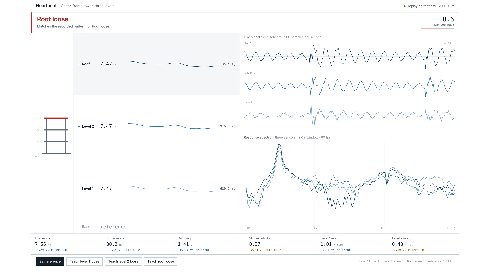

# Heartbeat

A three-storey steel-and-plywood tower, three accelerometers, and software that can tell you
**which floor's connection has come loose** — by listening to how the structure rings.

Tap the roof. The tower rings and dies away. That ring carries the structure's frequencies,
its damping, and its mode shape. Loosen one bolted joint and all three change, each floor in
a different and repeatable way. The monitor learns those patterns once and then reports, live,
whether the frame is sound and where the fault is.

Built solo at SharkByte 2026, Miami Dade College North, 6–8 November.



---

## Result

**Blind test: 25 of 25 correct.** Another person set the tower's state while I looked away —
nothing loose, level 1, level 2 or the roof, their choice of which side — and I read the verdict
off the screen. Sound-tower trials were included throughout and none raised a false alarm.

With 25 trials, 25/25 bounds the true accuracy at **89% or better at 95% confidence**
(Clopper–Pearson). Quoting the interval rather than "100%" is the honest way to report a
finite sample.

Supporting measurements, all on held-out data:

| Check | Result |
|---|---|
| 15-second windows, trained on the first 60% of each capture and tested on the rest | 16 / 16 |
| Steady-state verdicts across 203 taps and six tower states | 0 wrong |
| All 24 transitions between states | 0 contradictions |
| Trained on soft taps only, tested on hard taps (strength roughly doubled) | 4 / 4 |
| Damage index, four sound captures, 119 rolling 14-tap windows | 0.0 – 4.0 |
| Damage index, three loosened states, 80 rolling 14-tap windows | 6.5 – 60.7 |

The gap between those last two rows is why the alarm thresholds sit at 4.5 and 5.5.

---

## The idea

A building's natural frequency is set by its stiffness and its mass. Lose stiffness —
a connection slips, a weld cracks, a bolt backs out — and the frequency falls. This is the
basis of real structural health monitoring, and it is used on bridges and tall buildings today
under the name *operational modal analysis*.

The hard part is not detecting that *something* is wrong. It is saying *where*. One number
can only tell you the whole structure got softer.

This monitor uses three things together:

1. **Frequencies.** The first bending mode bends mostly in the bottom storey, so it is
   sensitive to damage low down and nearly blind to damage at the top. The third mode bends
   most in the upper storeys and behaves the other way around. Watching both separates
   "something is loose" from "it is loose up there".
2. **Mode shape, measured in three frequency bands.** How far each floor moves for a given
   amount of roof motion, measured separately around 8 Hz, 18 Hz and 34 Hz. This is what
   finally separated level 2 from the roof — on the first mode alone they look nearly
   identical, and an earlier version of this code confidently swapped them.
3. **Slip sensitivity.** A tight bolted joint behaves the same however hard you hit it.
   A loose one slips, and the slip grows with the force — so its damping *rises* with tap
   strength while a tight joint's stays flat. That slope is near zero on a sound frame and
   clearly positive on a damaged one, and because it is a trend rather than a value, it does
   not care how hard you tapped.

---

## How it works

```
  Feather ESP32-S2 ── USB ──► monitor.py ──► http://localhost:8000
   3 accelerometers            tap detection, fingerprint,
   200 samples/second          diagnosis, web console
```

**Firmware** (`firmware/heartbeat_firmware.ino`) reads all three accelerometers over one I²C bus by
talking to their registers directly — no driver libraries — and streams timestamped CSV at
exactly 200 samples per second.

**The monitor** (`monitor.py`) runs two threads that share no mutable state. One parses serial
lines and posts them to a queue; the other owns every buffer, does the analysis, and publishes
a finished read-only snapshot that the web console reads. Per tap it measures:

- the decay rate of the ring, and the amplitude of the tap that caused it
- the motion of each floor relative to the roof, in three frequency bands

Taps are found by **prominence**, not level: while the tower is being tapped it is ringing most
of the time, so the average level says nothing about where a tap is. The last 14 taps are pooled
into a fingerprint of ten numbers. Frequencies come from averaging the spectra of the individual
tap windows rather than one long FFT — repeated taps smear a long FFT into a comb of sidebands
whose tallest tooth hops around by several Hz.

**Diagnosis** answers two separate questions on purpose:

- *Is anything loose?* A single damage index built from the drop in both frequencies, the rise
  in damping, and the appearance of slip. All move the same way for any loosened joint, so this
  works on a connection it has never seen loosened.
- *Which floor?* The **direction** the fingerprint moved, matched against patterns recorded on
  this tower. Direction rather than distance, because loosening a nut further pushes the same
  pattern further without changing its shape. Matching on distance meant a gentle loosening of
  the roof landed nearer the recorded *level 2* than the recorded roof; matching on direction is
  correct down to a quarter of the loosening it was taught.

### This tower's numbers

Reference, all connections tight: **first mode 7.81 Hz, upper mode 34.86 Hz, damping 1.58%.**

| Loosened | First mode | Upper mode | Damping | Slip | Level-1 motion, upper band |
|---|---|---|---|---|---|
| Level 1 | **−17.5%** | −0.6% | **×4.8** | — | +0.16 |
| Level 2 | −3.7% | **−9.1%** | +1.5% | **+0.58** | +0.03 |
| Roof | −3.1% | **−12.3%** | −2.3% | +0.30 | **−0.26** |

Three distinct signatures. Note how little the first mode moves for the upper two floors, and
how much the upper mode does — that asymmetry is the whole reason the second feature family
exists.

---

## It also works with nobody touching it

A tapped measurement is a stand-in for what a real building gets for free. To check how far
that goes, I recorded the tower with nothing touching it or the table.

The first mode is clearly visible in ordinary room vibration — footsteps, the building, the
air handling — at **125× the sensor noise floor** on the roof sensor. The tower was moving
**3.0 µm RMS**, about one twentieth the thickness of a human hair, and about 1/3700 of a tap.

Loosening level 1 and recording again with nobody touching it, the ambient frequency fell from
**8.25 Hz to 7.10 Hz, a 13.9% drop** — the tower reported its own damage with no human
intervention at all.

Two honest limits. The ambient frequency (8.25 Hz) is *higher* than the tapped one (7.81 Hz),
because at microscopic amplitudes the bolted joints grip instead of slipping — the same
nonlinearity the slip feature measures — so ambient monitoring needs its own reference. And
over 20-second windows the ambient estimate wanders about 1–2%, which is fine against level 1's
14% shift but marginal against the 3% shifts from level 2 and the roof.

Real buildings are the *easy* case here: they are excited continuously by wind and traffic,
they are far more flexible, and real monitoring accelerometers have noise floors around
1 µg/√Hz — roughly ten thousand times quieter than the hobby MEMS parts taped to this plywood.

---

## Hardware

| Part | Where | Address |
|---|---|---|
| Adafruit ESP32-S2 Feather | base | — |
| ADXL345 | level 1 | 0x53 |
| ICM-20948 | level 2 | 0x69 |
| Arduino Modulino Movement (LSM6DSOX) | roof | 0x6A |

Daisy-chained with 200 mm STEMMA QT cables; one I²C bus, one USB cable, no soldering.

**The tower.** Four columns cut from 16-gauge perforated steel flat bar to 15.5 in. A 12×12 in
plywood base and three 9×9 in plywood floors at 5.75, 10.75 and 15.75 in. Each floor meets each
column through a corner brace, bolted with a #8-32 machine screw, a fender washer and a **wing
nut** — which is the point: a wing nut is a connection you can loosen by hand, repeatably, by a
measured amount, and tighten back again.

---

## Running it

```bash
pip install numpy scipy pyserial
python monitor.py --port COM17          # add --app for a window with no browser chrome
```

Open <http://localhost:8000>.

**Teaching it a tower** takes about fifteen minutes, once:

1. All connections tight. Press **Set reference** and tap for 45 seconds, varying how hard.
2. Loosen one floor's connections, press that floor's **Teach** button, tap for 45 seconds,
   then retighten.
3. Repeat for the other floors.

Every training capture is also written to `data/` as plain CSV, so the analysis can be redone
later without taking the tower apart again. Every result in this README was produced that way,
and the recordings behind them are in [`data/`](data/) — including two with nobody touching the
tower at all.

```bash
python monitor.py --replay data/roof.csv    # drive the console from a recording
python record.py baseline 60 COM17          # capture raw data to CSV
```

Replay mode is also the backup demo if the hardware fails in front of a judge.

---

## The tower loosened itself, and the monitor noticed first

Late on the second evening the console started reporting a loose connection on a tower I was
certain was tight, and I spent a while convinced the software had broken. It hadn't. A 45-second
recording showed the first frequency rock steady at 7.74 Hz against a 7.81 reference — no
stiffness lost at all — while the decay rate had started climbing with tap strength: a slope of
**+0.41**, against −0.10 on the original baseline and +0.08 on a previous hand-retightening.

That is micro-slip, and it is what slip sensitivity exists to find. Several hundred taps had
backed a wing nut off far enough to slip under load but not far enough to soften the frame.
Tightening everything by hand and re-recording put the slope back to **+0.03** and the verdict
back to All clear. The joint was caught before any frequency moved.

It also exposed a real weakness. Slip is a slope divided by the fitted intercept, and over a
fourteen-tap window that intercept can land near zero and throw the ratio to 28 — against 0.5
for a genuinely loose joint — which drove the damage index to 95. The fit now discards decay
measurements corrupted by a tap landing mid-ring, trims outliers on median absolute deviation
rather than standard deviation (an outlier inflates the standard deviation enough to survive its
own cut), and holds the ratio inside the range physically reachable on this tower. Across all
eight captures the worst sound reading fell from 95 to 4.0, every loosened floor stayed above
6.5 and was still named correctly in all 80 windows, so the thresholds were re-derived at
4.5 and 5.5.

## What I would fix next

- **One fault at a time.** It is trained on a single loose connection. Loosen two floors at once
  and the damage index goes high but the pattern matches no stored floor, so it says exactly
  that rather than guessing. Correct behaviour, but a limitation.
- **Temperature.** On a real building, temperature and occupancy shift the natural frequency by
  a few percent — comparable to moderate damage. This is the central open problem in the field.
  A tower sitting in one room for a day sidesteps it entirely.
- **The reference is tied to one physical build.** Rebuild a joint and the fingerprint moves;
  I rebuilt the roof connection mid-project and had to re-teach everything.
- **Twenty-five blind trials bounds accuracy at 89% or better, not at 100%.** Tightening
  that further needs more trials, and ideally a second tower to show the method transfers.

---

## Built with

Python 3.11, NumPy, SciPy, pySerial. Arduino ESP32 core. HTML, CSS and vanilla JavaScript for
the console — no frontend framework, and the FFT behind the live spectrum is about thirty lines
of JavaScript so the page has no runtime dependencies at all. IBM Plex Sans and Mono.

## A note on AI assistance

I used Claude throughout, as a collaborator rather than a code generator. It wrote most of the
Python and the firmware; I built the tower, ran every experiment, and supplied all the data.
More usefully, it was wrong several times in ways that mattered and that the experiments caught:
it confidently swapped level 2 with the roof until the mode-shape bands were added; it
attributed a repeatability problem to my retightening when my own recordings showed the
retightening was fine; and an early threading bug of its own making was silently dropping one
reading in eight. Each of those was found by measuring rather than by assuming, and the fixes
are documented above.
